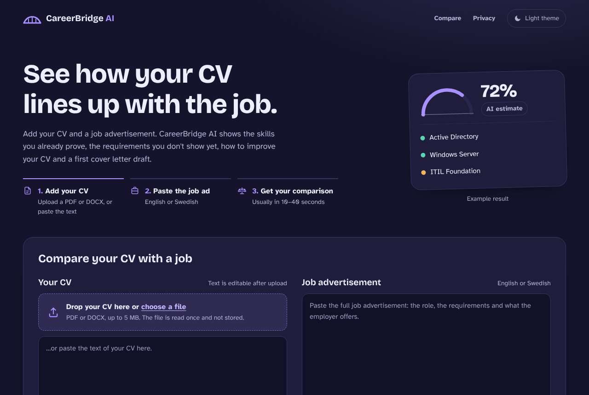
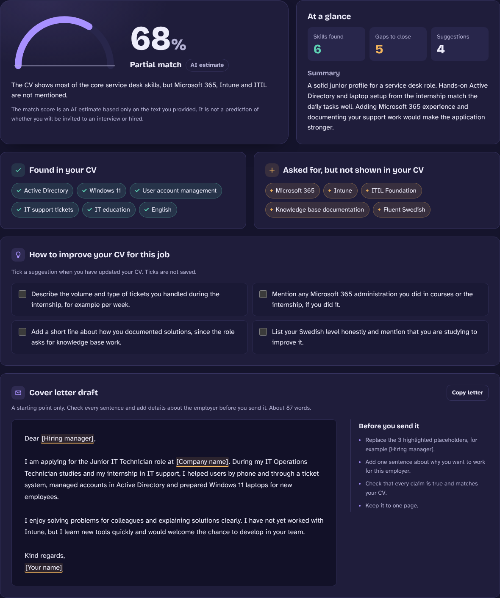
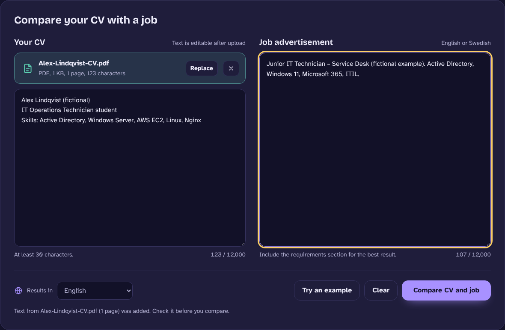
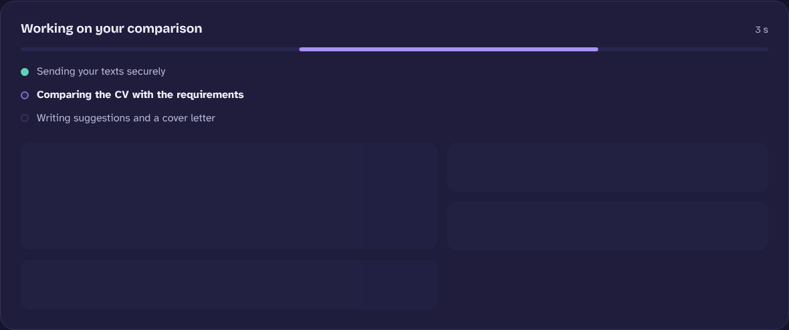
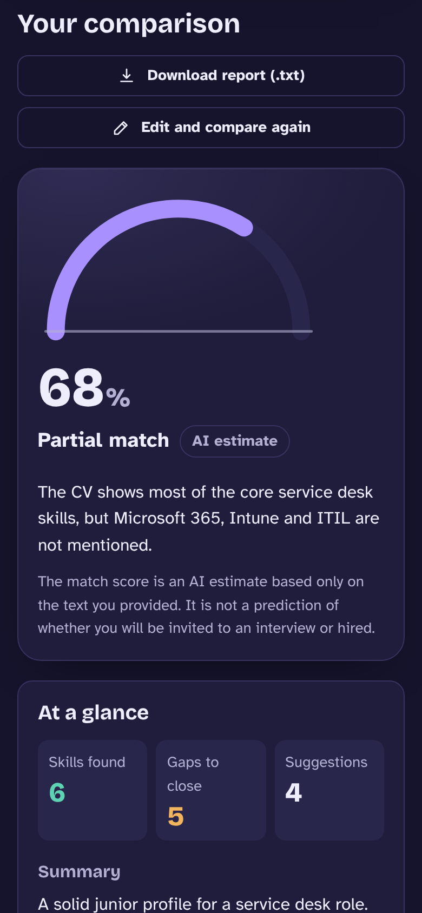
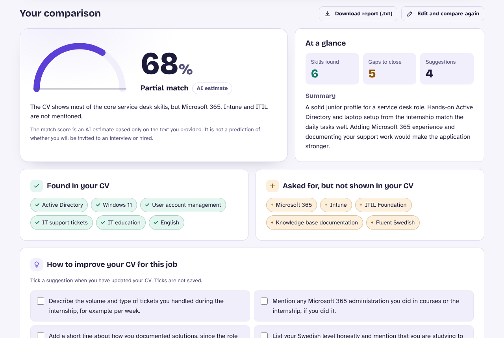

# CareerBridge AI

[](https://github.com/nedababaki-pixel/careerbridge-ai/actions/workflows/tests.yml)

Compare a CV with a job advertisement and get an honest, structured comparison: an AI-estimated match score, the skills the CV already shows, the requirements it does not show, concrete CV suggestions and a cover letter draft.

Built with **Python, Flask** and the **Google Gemini API**, and hosted with **Gunicorn and Nginx on AWS EC2**. This is the first web application I built and hosted on AWS during my internship at Nation Enterprises; version 2 improves its security, reliability, design and test coverage.

**Author:** Saiedeh Babaki, Stockholm, Sweden





## Features

- **Structured AI analysis** – Gemini answers in a fixed JSON schema: match score (shown as an *AI estimate*, not a hiring prediction), matching skills, missing skills, CV suggestions and a cover letter draft.
- **PDF and DOCX upload** – the text is extracted in memory and placed in the form so you can check it first. Files are never stored.
- **English or Swedish results** – useful for Swedish job ads. The interface is in English.
- **Honest by design** – the prompt forbids invented qualifications and exaggerated experience.
- **Results dashboard** – score card, counters for skills found and gaps, a checklist of CV suggestions and a cover letter card.
- **Clear progress and errors** – a progress view while the AI works, a cancel button and plain-language error messages.
- **Accessible, responsive interface** – desktop, tablet and phone layouts, dark and light themes, keyboard support, screen-reader friendly messages. No third-party scripts.
- **Copy and download** – copy the cover letter or download the full report as a text file.

| Uploaded CV | Progress | Phone | Light theme |
|---|---|---|---|
|  |  |  |  |

## Tech stack

| Area | Technology |
|---|---|
| Backend | Python 3.10+, Flask, Flask-Limiter, requests |
| AI | Google Gemini API, structured JSON output (default model `gemini-3.6-flash`, fallback `gemini-3.8-flash`) |
| Files | pypdf, python-docx |
| Frontend | HTML, CSS and JavaScript without frameworks or CDNs; self-hosted fonts |
| Testing | pytest, Playwright (Chromium), axe-core – 166 tests, GitHub Actions CI |
| Hosting | AWS EC2, Linux, Gunicorn, Nginx reverse proxy; v2 adds systemd and HTTPS with Let's Encrypt (configuration in `deploy/`, not yet live) |

## Run locally

```bash
python -m venv .venv
source .venv/bin/activate          # Windows: .venv\Scripts\activate
pip install -r requirements.txt
cp .env.example .env               # then add your Gemini API key in .env
python app.py
```

Open http://127.0.0.1:5055 and click **Try an example**.
Without a key the app still starts and explains that the AI key is not configured.

## Run the tests

```bash
pip install -r requirements-dev.txt
python -m playwright install chromium
python -m pytest                    # 166 tests, no API key or internet needed
```

See [docs/TESTING.md](docs/TESTING.md) for what each suite covers.

To check the **real** Gemini integration once with your own key (two API requests, English and Swedish; the key is never printed):

```bash
python scripts/gemini_diagnose.py     # fast checks: key, model, response time (short timeouts)
python scripts/gemini_smoke_test.py    # full comparison in English and Swedish
```

A step-by-step demo script is in [docs/DEMO.md](docs/DEMO.md).

## Security and privacy

- The API key stays on the server and is never logged, sent to the browser or put in a URL.
- CV text and files are processed in memory, not stored, not logged and not cached.
- Strict Content-Security-Policy and security headers; AI output is inserted as plain text.
- Input validation, request size limits and rate limiting protect the API key from abuse.
- In production, port 80 only redirects to HTTPS, so CV data is never sent unencrypted.
- The CV and job ad are sent to the Google Gemini API to create the comparison.

Details: [docs/SECURITY.md](docs/SECURITY.md).

## Deployment

The [deploy](deploy) folder contains a Gunicorn config, a hardened systemd service, an Nginx config for HTTP (port 80 → redirect) and HTTPS (port 443), Let's Encrypt setup and renewal, and two **read-only** check scripts for the server and the public site.
Step-by-step guide, HTTPS options without a domain and test results: [docs/DEPLOYMENT.md](docs/DEPLOYMENT.md).

## Project structure

```
app.py                 Flask app: routes, validation, security headers, rate limits, Gemini call
analysis.py            Prompt, JSON schema and validation of the AI answer
cv_extract.py          Safe text extraction from PDF and DOCX files
templates/index.html   Page structure
static/                CSS, JavaScript, fonts and icon
tests/                 Unit, security and upload tests; tests/e2e: browser and accessibility tests
scripts/               gemini_diagnose.py and gemini_smoke_test.py: real Gemini checks with your own key
deploy/                Gunicorn, systemd, Nginx, Certbot and check scripts
docs/                  Architecture, security, testing, deployment, screenshots
```

Architecture and API reference: [docs/ARCHITECTURE.md](docs/ARCHITECTURE.md). Version history: [CHANGELOG.md](CHANGELOG.md).

## Limitations

- The score is an AI estimate based only on the text provided. It can be wrong and says nothing certain about a recruitment outcome.
- Scanned PDFs (images) cannot be read; paste the text instead.
- The default rate limit is stored per server process. Use a shared store such as Redis for several servers.

## License

[MIT](LICENSE) © 2026 Saiedeh Babaki. Fonts: Bricolage Grotesque and Atkinson Hyperlegible, SIL Open Font License (see `static/fonts`).
