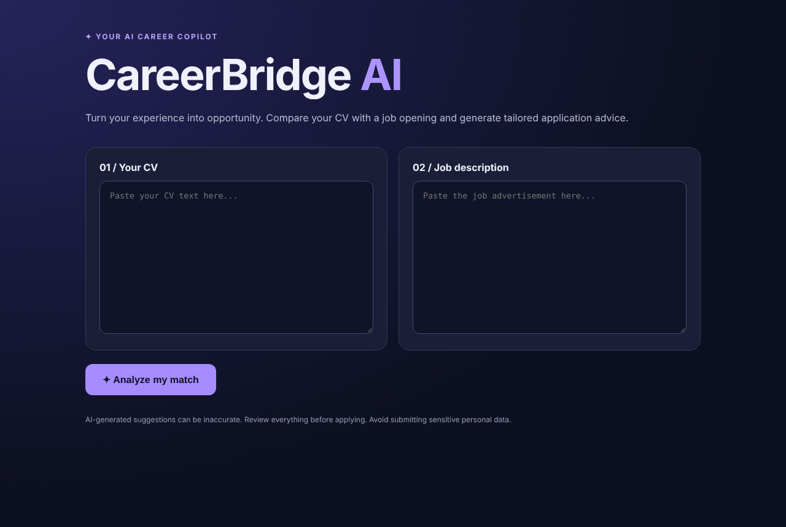

# CareerBridge AI

[](https://github.com/nedababaki-pixel/careerbridge-ai/actions/workflows/tests.yml)

An AI-powered assistant that compares a CV with a job advertisement and suggests how to close the gap.
Built with **Python, Flask** and the **Google Gemini API**.

**Author:** Saiedeh Babaki · Stockholm, Sweden



## What it does

Paste a CV and a job advertisement. CareerBridge AI returns:

- **Match summary** – how well the CV fits the role
- **Strengths** – what already matches
- **Skill gaps** – what is missing
- **CV improvements** – concrete suggestions
- **Cover letter draft** – a first draft based only on what the CV actually says

## Tech stack

| Area | Technology |
|---|---|
| Backend | Python 3.10+, Flask |
| AI | Google Gemini API (REST, default model `gemini-3.8-flash`) |
| Frontend | HTML, CSS and JavaScript in one template, responsive layout |
| Testing | pytest – 15 automated tests, Gemini API mocked |
| Production server | Gunicorn (included in `requirements.txt`) |

## Security by design

- The Gemini API key stays on the server (`.env`, never committed) and is sent in a request header, never in the URL or to the browser.
- Input validation: both fields need at least 30 and at most 12,000 characters.
- The CV and job ad are treated as untrusted data in the prompt, to reduce prompt-injection risk.
- The prompt tells the model not to invent qualifications or exaggerate experience.
- Errors from the AI service are shown as a friendly message, without internal details.
- No CV data is stored in a database.
- A `/health` endpoint is available for monitoring.

## Run locally

```bash
python -m venv .venv
source .venv/bin/activate          # Windows: .venv\Scripts\activate
pip install -r requirements.txt
cp .env.example .env               # then add your Gemini API key
python app.py
```

Open http://127.0.0.1:5055.

## Run the tests

```bash
pip install -r requirements-dev.txt
python -m pytest -v
```

The tests cover the pages, the health check, input validation, API key handling, model selection, prompt safety and error handling.
The Gemini API is replaced by fake responses, so no API key or internet connection is needed.

## Deploying to AWS (guide)

This repository contains the application only. It does **not** include Terraform or server configuration files.
A typical production setup on an AWS EC2 instance:

- Gunicorn as the WSGI server, with Nginx as a reverse proxy and HTTPS
- Security groups that only open the ports that are needed
- The API key stored as a server-side secret, not in the code
- Never expose Flask's development server to the internet

Note: AWS usage can incur charges.

## Limitations

- Submitted text is sent to the Gemini API provider. Do not upload sensitive CV data without consent and a privacy policy.
- A public deployment would also need rate limiting, abuse protection and a privacy/legal review.

## License

[MIT](LICENSE) © 2026 Saiedeh Babaki
