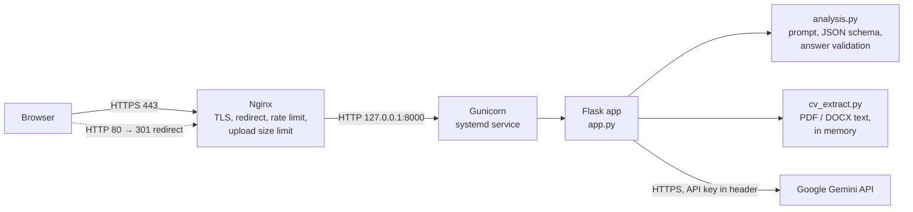

# Architecture

CareerBridge AI keeps the original, simple architecture: **one Flask application** with a server-rendered page, a small JSON API and the Google Gemini API behind it. Version 2 split the original `app.py` into three focused modules and moved the CSS and JavaScript into static files, but the structure is the same.

## Request flow

1. **Page** – `GET /` renders `templates/index.html`. CSS, JavaScript and fonts are served from `/static` (no CDNs).
2. **Optional upload** – `POST /api/extract-cv` (multipart, one file). `cv_extract.py` checks the type, reads the text in memory and returns it. The text is placed in the CV field so the user can review and edit it before anything is sent to the AI.
3. **Comparison** – `POST /api/analyze` with `{"cv", "job", "language"}`. The app validates the input, builds the prompt and JSON schema (`analysis.py`) and calls Gemini.
4. **Validation** – Gemini's JSON answer is validated and normalised (`analysis.parse_result`) before it is returned to the browser.
5. **Display** – `static/js/app.js` renders the score, skills, suggestions and cover letter with `textContent` only.

## API

| Method | Path | Body | Success response |
|---|---|---|---|
| `GET` | `/health` | – | `{"status": "ok"}` |
| `POST` | `/api/extract-cv` | `multipart/form-data`, field `file` (PDF or DOCX, ≤ 5 MB) | `{"text", "characters", "truncated", "file_type", "pages"}` |
| `POST` | `/api/analyze` | `{"cv": str, "job": str, "language": "en" \| "sv"}` | `{"analysis": {...}, "language", "disclaimer"}` |

`analysis` contains `match_score` (0–100), `score_label`, `score_explanation`, `summary`, `matching_skills`, `missing_skills`, `suggestions` and `cover_letter`.

Every API error is JSON: `{"error": "<message for the user>"}`.

| Status | Meaning |
|---|---|
| 400 | Invalid input (missing, wrong type, too short or too long, unknown language) |
| 413 | Request or file too large |
| 415 | File type not supported or file content does not match the extension |
| 422 | File cannot be read (damaged, encrypted, scanned, too many pages) or the AI refused the text |
| 429 | Rate limit reached |
| 502 | AI service error or unusable AI answer |
| 503 | API key not configured, or AI quota reached |
| 504 | AI service too slow |

## Modules

| File | Responsibility |
|---|---|
| `app.py` | Flask app, routes, validation, security headers, error handling, rate limits, Gemini call |
| `analysis.py` | Prompt, Gemini response schema, answer validation and normalisation |
| `cv_extract.py` | Safe text extraction from PDF (pypdf) and DOCX (python-docx) |
| `templates/index.html` | Page structure (accessible form and results) |
| `static/css/app.css` | Design tokens, dark and light themes, responsive layout |
| `static/js/app.js` | Validation, upload, request handling, rendering, copy and download |
| `deploy/` | Gunicorn, systemd, Nginx and Certbot configuration and read-only check scripts |

## Configuration

All settings are environment variables (see `.env.example`): `GEMINI_API_KEY`, `GEMINI_MODEL`, `GEMINI_TIMEOUT`, `TRUST_PROXY`, `RATE_LIMIT_ANALYZE`, `RATE_LIMIT_UPLOAD`, `RATELIMIT_STORAGE_URI`, `LOG_LEVEL`, `PORT`.

## Timeouts

| Layer | Timeout | Why |
|---|---|---|
| Browser (`fetch`) | 115 s | User can also cancel at any time |
| Nginx `proxy_read_timeout` | 125 s | Longer than the app's wait |
| Gunicorn worker `timeout` | 120 s | Longer than the Gemini wait (the original default of 30 s killed slow requests) |
| Gemini request | 10 s connect + 90 s read | Clear `504` message instead of a hanging request |
